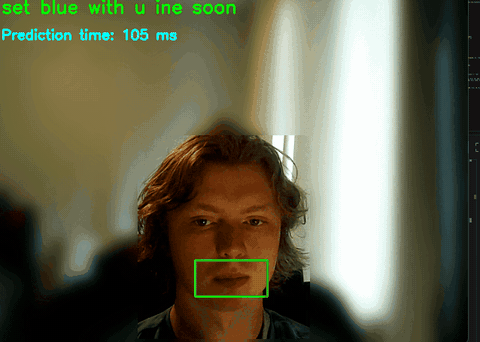

# Lip Reading on GRID

[](https://github.com/Vlvasile/lip-reading-grid/actions/workflows/ci.yml)

I wanted to build a model that reads speech from lips only, with no audio, and then try it on myself through a webcam. I trained it on the GRID corpus, checked it on a speaker it never saw during training, wrapped it in a FastAPI service with Docker, and added tests and CI.



This is me testing it live (background blurred in the demo script). I press Space, say a sentence for 3 seconds, and the model prints what it thinks I said. My face is new to the model, so most words come out wrong. More on that below.

## What I wanted to find out

1. How well does it work on a person it has never seen?
2. Which words are hardest to read from lips?
3. Does it work on me through a normal webcam?
4. Is it fast enough to run in real time?

## Results

| Model | Seen speakers (val, s1–s3) | Unseen speaker (test, s4) |
|---|---|---|
| kNN baseline | 78.2% | 17.7% |
| 3D-CNN + BiGRU + CTC | 90.0% | 25.7% |

Numbers are word accuracy. For the neural network on s4: WER 0.74, CER 0.52.

The kNN baseline classifies single words that are already cut out using the GRID alignment timestamps. The neural network gets the whole 3-second video and has to find the words on its own, so it has the harder task, and it still does better on the unseen speaker.

The big gap between seen and unseen speakers is the main thing I learned here. I trained on only 3 speakers, so the model learns how *those* people move their lips instead of lip reading in general. I don't think a bigger model would fix this. More speakers would.

Which words are hard: commands (bin, lay, place, set), colours and adverbs are read pretty well. Single letters and prepositions (at, by, in, with) are the worst. They are short and many of them look almost the same on the lips, for example "b", "p" and "m" all start with closed lips.

On my own face the model gets very few words right. It also tends to repeat the same words ("blue", "soon") no matter what I say, which looks like it falls back to the most common patterns it saw in training when the input looks unfamiliar.

Speed: one 3-second phrase takes 25–115 ms on my GPU (RTX 4060 Ti) after the first warm-up call. In the Docker container on CPU, one full request with face detection, cropping and inference took 473 ms.

Example from the API on an unseen-speaker video (`s4/bbae9n.mpg`):

```
said:      bin blue at e nine now
predicted: lay white in s ine now
```

## Data

GRID corpus, speakers s1–s4, 1000 videos each. Every video is 3 seconds, 75 frames at 25 fps, and every sentence has the same structure:

```
command  colour  preposition  letter  digit  adverb
bin      blue    at           f       two    now
```

51 words in total. I dropped 40 videos: 14 that did not have 75 frames and 26 with a broken first frame. That left 3960 videos.

The split is by speaker: train and validation come from s1–s3, and s4 is only used for testing. If I split randomly, the same person would be in train and test and the accuracy would look much better than it really is.

## How it works

**Mouth crop.** MediaPipe FaceMesh finds face landmarks on every frame. I take the lip corners and the top and bottom lip points (landmarks 61, 291, 0, 17), take the centre, and cut a box twice as wide as the distance between the lip corners. The crop is resized to 80×40 and converted to grayscale. The same code (`src/mouth.py`) is used for training data, the webcam demo and the API, so the model always gets the same kind of input.

**Model** (`src/model.py`), about 8M parameters, similar to LipNet:

```
input (1, 75, 40, 80)               1 channel, 75 frames, 40×80 pixels
3 × [Conv3d → ReLU → MaxPool3d(1,2,2) → Dropout3d(0.3)]
    channels 32 → 64 → 96            pooling only in space, so all 75 time steps stay
reshape to (75, 96·5·10)
2-layer bidirectional GRU, hidden size 256
Linear → log-softmax over characters
CTC loss for training, greedy decoding for prediction
```

CTC is what lets the model learn without knowing which frame belongs to which letter. It outputs a character (or a blank) for every frame, and the decoder removes repeats and blanks to get the text.

**Training** (`src/train.py`): Adam, checkpoints, early stopping and learning rate scheduling, all logged to MLflow. After the first 30 epochs I ran two 50-epoch continuations: run A without augmentation and run B with horizontal flips. Flipping did not help on validation, so I picked run A by validation loss.


**kNN baseline**: k=9, distance-weighted, on mouth crops of a single word with the average frame of the video subtracted. I tuned k and the features only on validation, and looked at s4 only at the end.

## MLOps part

- **MLflow** for runs and metrics, plus the Model Registry. The model is registered as `lipreading-grid` with the alias `champion`, and the API loads it by that alias, not by a file path.
- **FastAPI** service with `GET /health` and `POST /predict`.
- **Docker** image with CPU-only PyTorch. The container has no access to my MLflow database, so `src/export_model.py` copies the champion model into `model_export/`, and the API reads the `MODEL_URI` environment variable to know where to load it from. Same code works locally and in Docker.
- **pytest**: model output shape, frame resampling, `/health`, and that `/predict` returns 422 instead of crashing when the file is not a video.
- **GitHub Actions**: runs the tests, then builds the Docker image, starts it and calls `/health`.

## Running the API

```bash
docker build -t lipreading-api .
docker run --rm -p 8000:8000 lipreading-api
```

Open `http://localhost:8000/docs` or send a video:

```bash
curl -F "video=@bbae9n.mpg" http://localhost:8000/predict
```

```json
{
  "text": "lay white in s ine now",
  "frames_with_mouth": 75,
  "processing_time_ms": 473
}
```


## Webcam demo

```bash
python webcam_read.py
```

Press Space, say a GRID sentence within 3 seconds (for example "place red at c two now"), press Q to quit. The webcam gives about 90 frames in 3 seconds, so I resample them to 75 to match GRID. The demo loads a checkpoint from `models/`, which is not in the repo because of its size.

## Running locally

```bash
conda create -n lip python=3.11
conda activate lip
pip install -r requirements.txt

python src/download_grid.py        # downloads GRID s1–s4 from Zenodo
python -m src.train --help         # training options
python -m pytest -v
python -m uvicorn api.main:app     # API without Docker
```

## Project structure

```
api/main.py              FastAPI service
src/
  download_grid.py       download GRID
  data.py                dataset and character encoding
  mouth.py               mouth detection and cropping
  model.py               3D-CNN + BiGRU model
  evaluation.py          CTC decoding, WER and CER
  train.py               training with MLflow logging
  register_model.py      register a checkpoint in MLflow
  export_model.py        export the champion model for Docker
  inference.py           video to text
tests/                   pytest
notebooks/               data checks, preprocessing, baselines, experiments
model_export/            exported model for Docker and CI
webcam_read.py           live demo
webcam_test.py           check the mouth crop on the webcam
Dockerfile
requirements.txt         full environment
requirements-api.txt     only what the API needs
.github/workflows/ci.yml
```

## What I would do next

- Train on more GRID speakers and plot how accuracy on an unseen speaker grows with the number of training speakers.
- Fine-tune on a few minutes of my own recordings and compare webcam results before and after.
- Compare with a pretrained open-vocabulary model (for example Auto-AVSR) on LRS3. GRID has only 51 words and one sentence template, so this model can't read normal speech.

## Stack

Python, PyTorch, MediaPipe, OpenCV, scikit-learn, MLflow, FastAPI, Uvicorn, Docker, pytest, GitHub Actions

## Data source

M. Cooke, J. Barker, S. Cunningham, X. Shao. *An audio-visual corpus for speech perception and automatic speech recognition.* Journal of the Acoustical Society of America, 120(5), 2006. Downloaded from Zenodo.
