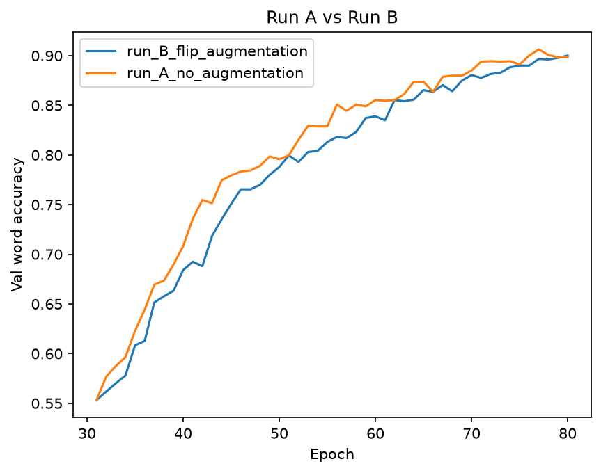
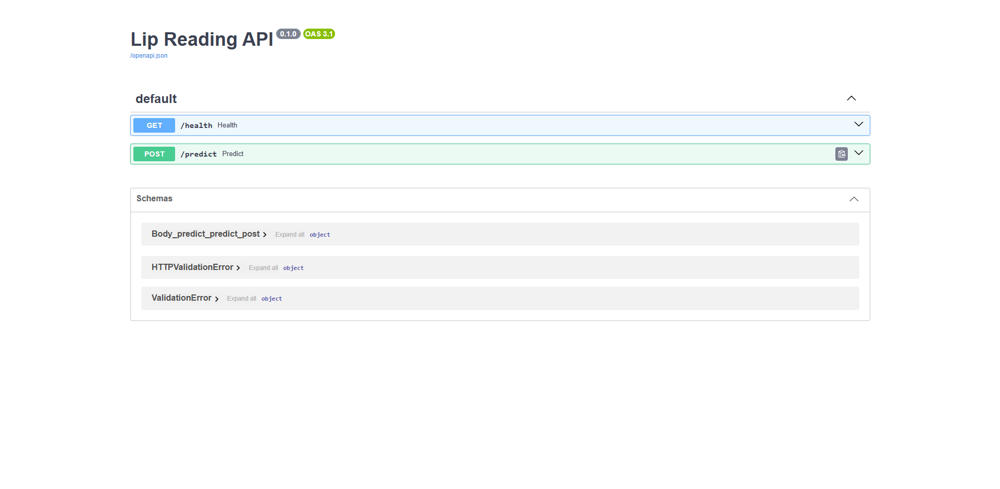
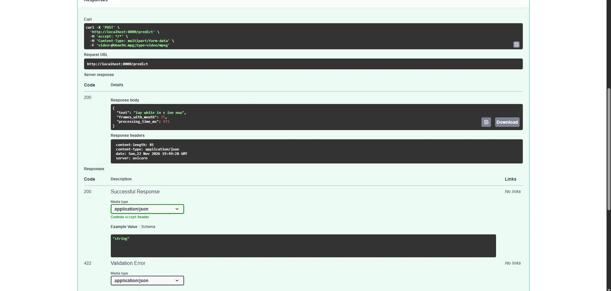

# Lip Reading on GRID: from silent video to text

[](https://github.com/Vlvasile/lip-reading-grid/actions/workflows/ci.yml)

A visual speech recognition project: the model watches a video of a person's mouth **without any audio** and outputs the sentence they said. It is trained on the GRID corpus, tested on a speaker it has never seen, served as a FastAPI service in Docker, and run live on my own webcam.


*Live demo on my webcam (background blurred). The phrase is recorded for 3 seconds, then the model predicts the text. My face is new to the model, so most words are wrong; see [Results](#results).*

## Questions this project answers

1. **How accurate is the model on a speaker it has never seen?** → 25.7% word accuracy on unseen speaker s4 (vs 90% on seen speakers).
2. **Which words are hardest to read from lips?** → Commands, colours and adverbs are read well; short letters and prepositions are the hardest because they look almost the same on the lips.
3. **How does it work on me through a webcam?** → The full pipeline runs live, but accuracy on my face is low without fine-tuning.
4. **Is it fast enough for real time?** → Yes: about 25–115 ms per 3-second phrase on GPU after warm-up.

## Results

| Model | Seen speakers (val, s1–s3) | Unseen speaker (test, s4) |
|---|---|---|
| kNN baseline (k=9, distance-weighted, mean-subtracted pixels) | 78.2% | 17.7% |
| **3D-CNN + BiGRU + CTC** | **90.0%** | **25.7%** (WER 0.74, CER 0.52) |

Accuracy = share of correctly predicted words.

**Main finding:** both models read familiar faces well and an unfamiliar face badly. The gap comes from the data, not from model size: training used only 3 speakers, so the model learns *their* lips rather than lip reading in general. The neural network still beats the kNN baseline on the unseen speaker.

**Augmentation experiment.** I continued training for 50 more epochs in two MLflow runs: without augmentation (A) and with horizontal flips (B). Flipping gave no measurable gain on validation, so run A was selected by validation loss and registered as the production model.



**Example from the API (unseen speaker s4, video `bbae9n`):**

| | |
|---|---|
| Spoken | bin blue at e nine now |
| Predicted | lay white in s ine now |

## How it works

```
video (.mpg / webcam)
  → MediaPipe FaceMesh: find lip landmarks on every frame
  → crop mouth to 80×40, grayscale, resample to 75 frames
  → normalise
  → 3D-CNN (3 blocks) → 2-layer bidirectional GRU → linear layer
  → CTC greedy decoding → text
```

- **Data:** GRID corpus, speakers s1–s4, 1000 videos each (3 s, 75 frames). 40 videos were excluded (14 without 75 frames, 26 with corrupted first frames), leaving 3960. The list is kept in `excluded.csv`.
- **Split by speaker:** train and validation come from s1–s3; s4 is held out as the test set, so the test measures generalisation to a new person.
- **Baseline:** kNN on word-level features, tuned on validation only.
- **Model:** LipNet-style network (~8M parameters) trained with CTC loss in PyTorch.
- **Same preprocessing everywhere:** `src/mouth.py` is shared by data preparation, the webcam demo and the API, so the model always sees the same kind of input (no training/serving skew).

## MLOps

| Part | Tool |
|---|---|
| Experiment tracking | MLflow (parameters, metrics, run comparison) |
| Model registry | MLflow Model Registry: `lipreading-grid`, alias `champion` |
| Reproducible training | `src/train.py` command-line script (checkpointing, early stopping, LR scheduling) |
| Serving | FastAPI: `GET /health`, `POST /predict` |
| Container | Docker, CPU-only PyTorch |
| Tests | pytest: model output shape, frame resampling, API health, rejection of non-video files |
| CI | GitHub Actions: tests → Docker build → container health check |

The API loads the model by its registry alias (`models:/lipreading-grid@champion`). In Docker, the model is exported to `model_export/` and loaded through the `MODEL_URI` environment variable, so the same code works locally and in the container.

## API



Run with Docker:

```bash
docker build -t lipreading-api .
docker run --rm -p 8000:8000 lipreading-api
```

Then open `http://localhost:8000/docs`, or send a video:

```bash
curl -F "video=@bbae9n.mpg" http://localhost:8000/predict
```

Response:

```json
{
  "text": "lay white in s ine now",
  "frames_with_mouth": 75,
  "processing_time_ms": 473
}
```

`processing_time_ms` covers face detection, mouth cropping and model inference on CPU inside the container. If no mouth is found (for example, the file is an image), the API returns `422`.



## Live webcam demo

```bash
python webcam_read.py
```

Press **Space**, say a GRID-style sentence within 3 seconds (for example, *"place red at c two now"*), and the prediction and inference time appear on screen. Press **Q** to quit. The webcam records about 90 frames in 3 seconds, which are resampled to 75 to match GRID's frame rate and speaking speed.

The demo loads a local checkpoint from `models/`, which is not stored in the repository.

**GRID vocabulary:** command (bin, lay, place, set) · colour (blue, green, red, white) · preposition (at, by, in, with) · letter (a–z except w) · digit (zero–nine) · adverb (again, now, please, soon).

## Run locally

```bash
conda create -n lip python=3.11
conda activate lip
pip install -r requirements.txt

python src/download_grid.py        # download GRID speakers s1–s4
python -m src.train --help         # training options
python -m pytest -v                # run tests
python -m uvicorn api.main:app     # start the API without Docker
```

## Project structure

```
├── api/main.py              FastAPI service
├── src/
│   ├── download_grid.py     download GRID from Zenodo
│   ├── data.py              dataset and character encoding
│   ├── model.py             3D-CNN + BiGRU model
│   ├── evaluation.py        CTC decoding and metrics (WER, CER)
│   ├── train.py             training script with MLflow logging
│   ├── register_model.py    register a checkpoint in the MLflow registry
│   ├── export_model.py      export the champion model for Docker
│   ├── inference.py         video → mouth frames → text
│   └── mouth.py             shared mouth detection and cropping
├── tests/                   pytest tests
├── notebooks/               exploration, preprocessing, baselines, evaluation
├── model_export/            exported model used by Docker and CI
├── webcam_read.py           live lip reading demo
├── webcam_test.py           webcam mouth-crop check
├── Dockerfile
├── requirements.txt         full environment
├── requirements-api.txt     API-only dependencies
└── .github/workflows/ci.yml
```

## Limitations and next steps

- **Only 3 training speakers.** The biggest gain should come from more data: train on more GRID speakers and measure a learning curve (how accuracy on an unseen speaker grows with the number of speakers).
- **Fixed vocabulary.** GRID has 51 words and one sentence template, so the model cannot read free speech. Next: compare with a pretrained open-vocabulary model (e.g. Auto-AVSR) on LRS3.
- **Fine-tuning on my own recordings** to measure how much a few minutes of personal data improve webcam accuracy.

## Tech stack

Python · PyTorch · MediaPipe · OpenCV · scikit-learn · MLflow · FastAPI · Uvicorn · Docker · pytest · GitHub Actions

## Data

GRID audiovisual sentence corpus: M. Cooke, J. Barker, S. Cunningham, X. Shao, *"An audio-visual corpus for speech perception and automatic speech recognition"*, Journal of the Acoustical Society of America, 120(5), 2006. Downloaded from Zenodo.
